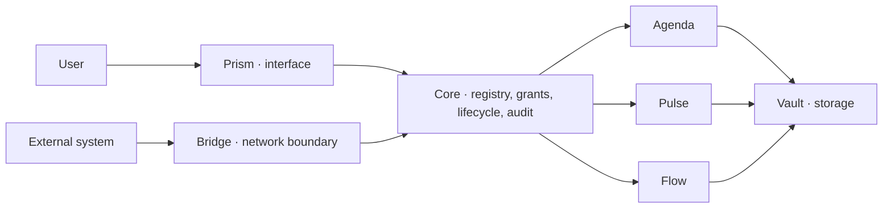

<!-- doc-key: home -->
<!-- parity-version: 2 -->
<!-- sections: overview,why,audience,architecture,control,status,examples,participate,documentation -->

# Ivy Developer Kit

[Nederlands](../nl/README.md) | **English**

> **Developer preview.** Ivy is not production-ready, the public API is not
> stable, and this repository does not contain the complete proprietary runtime.

<!-- section: overview -->
## What is Ivy?

Ivy is a local-first capability platform for building modular software systems
that remain under the user's control. Instead of one application owning every
domain, independent modules provide small, explicit and versioned capabilities.
Ivy Core selects the installed provider, evaluates declarations and exact
grants, routes the request and records the outcome.

Local-first means that local operation and local data are the normal path—not a
temporary offline cache around a mandatory cloud service. External services can
still participate through controlled modules and Bridge.

<!-- section: why -->
## Why does Ivy exist?

Digital tools often couple identity, storage, interface, automation and business
logic so tightly that users cannot replace one part without replacing
everything. Ivy separates these responsibilities. The goal is not another large
automation application or a storefront with plugins; the goal is a platform
where authority is bounded, providers are replaceable, and installation never
silently means permission.

<!-- section: audience -->
## Who is Ivy for?

- makers connecting local hardware or services;
- Rust, Dart and systems developers building modules and tools;
- privacy-focused self-hosters following the path to installable releases;
- organisations that need local, auditable coordination across domains;
- researchers working on durable, offline or capability-based systems.

Today the public repository is primarily for developers and technical
evaluators. Simple end-user installation is planned, not implemented.

<!-- section: architecture -->
## How do modules work together?



- **Core** is the proprietary platform authority for registry, grants, routing,
  lifecycle, health, audit and package trust.
- **Core UI** is the proprietary local administration interface.
- **Prism** composes generic user experiences and declarative widgets.
- **Bridge** is the controlled external network and channel boundary.
- **Vault** provides durable local storage capabilities.
- Domain modules such as Agenda and Pulse own their domain semantics.

Consumers invoke capability IDs, not hard-coded module IDs. One installed owner
may control a capability domain. The development simulator demonstrates this
model but is not Core and provides no production security boundary.

<!-- section: control -->
## What does user control mean?

A provider needs an exact offer grant. A consumer needs an exact invocation
grant and must have declared the capability as a requirement. Revoking either
grant stops subsequent development-simulator calls immediately. Production Ivy
adds authenticated caller identity, trusted context, process isolation,
persistence, lifecycle and audit guarantees that are not reproduced here.

<!-- section: status -->
## What works now?

**Implemented in private Ivy development:** capability-domain ownership,
default-deny grants, capability routing, Linux host foundations, native Prism
flows, signed local packages, and working system/domain modules.

**Experimental in this repository:** public manifest subset, Rust SDK,
development simulator, Dart types, manifest validator, module generator,
development signing, widget fixture preview, shared conformance fixtures and the
`hello-clock` example.

**Planned:** stable public runtime integration, official package validation,
reference modules, simple installation, upgrades, backup and Marketplace.

**Exploring:** federation, offline transport, mobility, optimisation, AI and
additional domain modules.

<!-- section: examples -->
## Practical examples

- Pulse time events can trigger a Flow routine; production integration exists
  privately, while public packaging is still planned.
- Agenda availability can support BookMe booking decisions; public reference
  source is not yet released.
- An external maker could provide an ESP32 capability through a reviewed module;
  the hardware adapter and public runtime bridge are planned.
- Independent modules can be free, paid, proprietary or open source when their
  author owns the necessary rights.

See [use cases](usecases/README.md) for precise status and capability flows.

<!-- section: participate -->
## Build and participate

```bash
cargo test --workspace --locked
cargo run -p ivy-cli -- validate examples/hello-clock/module.yaml
cargo run -p ivy-hello-clock
```

Start with the [first-module tutorial](tutorials/first-module.md), then read the
[contribution guide](community/contributing.md). Marketplace admission is a
separate version-specific ANWOR review. `ANWOR Official` and `ANWOR Verified`
must never be claimed without that approval.

<!-- section: documentation -->
## Documentation

- [Architecture and compatibility](architecture/overview.md)
- [Capabilities and grants](concepts/capabilities.md)
- [Events and widgets](concepts/events-widgets.md)
- [Developer Kit and manifest rules](development/developer-kit.md)
- [Use cases](usecases/README.md)
- [Module and Marketplace policy](modules/module-categories.md)
- [Contributing and first tasks](community/contributing.md)
- [Status and roadmap](project/status-roadmap.md)
- [Licensing and publication decisions](project/licenses-trademarks.md)
- [FAQ](faq/README.md)
