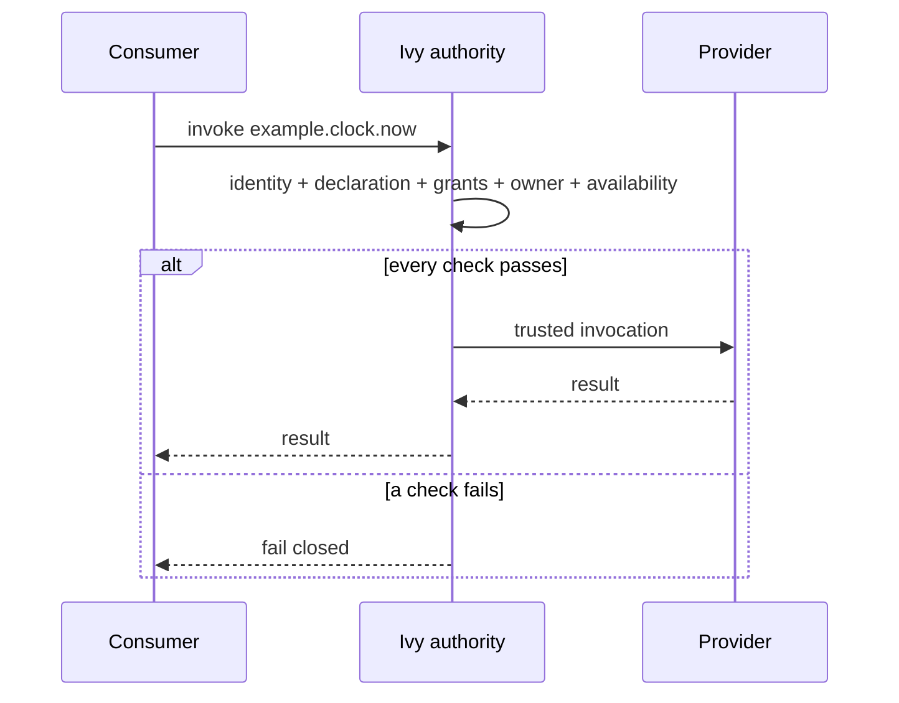
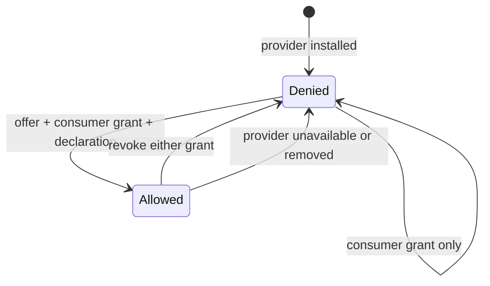

<!-- doc-key: capabilities -->
<!-- parity-version: 2 -->
<!-- sections: identifiers,ownership,invocation,grants,revocation,limits -->

# Capabilities: how Ivy modules work together safely

[Nederlands](../../nl/concepts/capabilities.md) | **English**

## Start here: what is a capability?

Ivy consists of modules that each handle a particular job. A **capability** is a clearly named function offered by a module that another module can use.

Imagine a smart-lighting module offering these functions:

- `home.lighting.turn_on` — turn a light on.
- `home.lighting.turn_off` — turn a light off.
- `home.lighting.get_state` — read a light's current state.

An automation module does not need to know how the light works internally. Instead, it requests a named function. **Ivy checks who offers it and whether the call is allowed.** A different implementation can take over the same suitable capability as long as ownership, contract and access rules are respected.

**Three useful terms:**
- **Provider:** the module offering a capability, such as the lighting module.
- **Consumer:** the module that wants to use it, such as the automation module.
- **Grant:** explicit permission. Declaring a function alone does not authorize offering or using it.

This page explains the architectural rules and what the **public simulator** can test. It does not promise that an external module can already connect through a public production API.

<!-- section: identifiers -->
## How do you identify modules and functions?

A **module ID** identifies a particular implementation. A **capability ID** identifies a versioned operation such as `example.clock.now`. A **capability domain** groups functions and defines the area a module can own, such as `example.clock`.

This separation lets consumers depend on a needed *function*, rather than hard-coding one particular provider module. Replacements must still satisfy the required version and compatible contract.

<!-- section: ownership -->
## Why can only one module own a domain?

Imagine two modules both claiming responsibility for the same lights. It would be unclear which one should receive a request. Ivy therefore allows **one exclusive installed owner** for each capability domain.

Ownership overlap is checked using dot-separated segments:

- `example.clock` and `example.clock` **conflict**: they are identical.
- `example.clock` and `example.clock.backup` **conflict**: one is a descendant of the other.
- `example.clock` and `example.clockwork` **do not conflict**: they contain distinct segment names.

A single manifest cannot claim overlapping domains either. In the simulator, failed registration is **atomic**: a failure does not leave a partially successful registration.

Ownership does **not** mean other modules can never use those functions. Access is controlled separately.

<!-- section: invocation -->
## What happens when one module calls a function?

Suppose an automation module wants the current time. It invokes `example.clock.now`. The provider executes the operation only after Ivy has checked the applicable conditions.

1. The **consumer** requests the capability.
2. **Ivy** checks identity, declaration, grants, ownership and availability, among other applicable requirements.
3. If all checks pass, Ivy routes the call to the **provider** and returns the result.
4. If any required check fails, Ivy **denies** the call (*fail closed*) instead of silently granting extra access.

The diagram shows that flow:

<!-- section: grants -->
## Why are there two separate permissions?

It might seem natural for an installed module to offer its functions immediately and for other modules to use them freely. Ivy **deliberately does not authorize that automatically**.

- A **provider offer grant** authorizes **one installed provider** to offer **one declared capability**.
- A **consumer invocation grant** authorizes **one declared consumer** to invoke that capability.

**Both grants must exist.** Provider permission alone is insufficient, and consumer permission alone is insufficient. There are no wildcard grants that enable every capability at once.

The public simulator supports only **statically declared consumer requirements**, not dynamic requests during execution.

<!-- section: revocation -->
## What happens when permission is revoked?

Permission is not permanent. **Revocation** means withdrawing a previously issued grant.

Even if a call worked earlier, subsequent calls must be denied if either grant is revoked or the provider becomes unavailable or is removed.

This diagram shows the change between denied and allowed:

<!-- section: limits -->
## What does the public simulator prove, and what does it not?

The public simulator lets developers test selected rules for manifests, domain ownership, declarations, availability, grants, routing and revocation.

**It is not the full secure Ivy Core.** It uses registered module IDs as test identities. Production Core authenticates actual callers and supplies a separate trusted context.

The simulator does **not** implement:
- dynamic capability request approval;
- process isolation;
- persistent grants;
- lifecycle fencing;
- audit.

Passing simulator checks is therefore **not production authorization or Marketplace certification**.

For more, see the [architecture overview](../architecture/overview.md), [manifest reference](../development/manifest-reference.md) and [conformance tests](../../../conformance/README.md).
