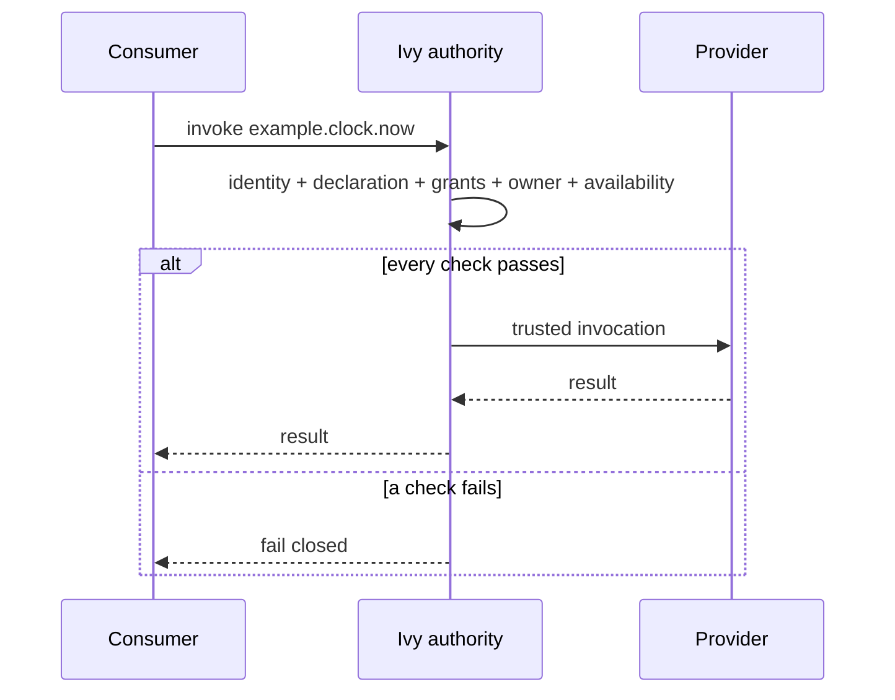
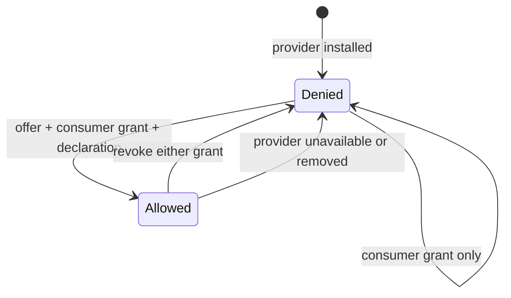

<!-- doc-key: capabilities -->
<!-- parity-version: 2 -->
<!-- sections: identifiers,ownership,invocation,grants,revocation,limits -->

# Capabilities, ownership and grants

[Nederlands](../../nl/concepts/capabilities.md) | **English**

<!-- section: identifiers -->
## Identifiers

A module ID identifies an implementation. A capability ID identifies a versioned
operation such as `example.clock.now`. A capability domain such as
`example.clock` defines authority. Consumers depend on capability IDs, not on a
specific provider module.

<!-- section: ownership -->
## Exclusive ownership

One installed module may own a domain. `example.clock` conflicts with both
`example.clock` and `example.clock.backup`; `example.clockwork` does not conflict
because overlap is evaluated by dot-separated segments. One manifest may not
claim overlapping domains either. Failed simulator registration is atomic.

<!-- section: invocation -->
## Capability flow

<!-- section: grants -->
## Two independent grants

A provider offer grant authorises one installed provider to offer one declared
capability. A consumer invocation grant authorises one declared consumer to call
that capability. Both must exist; there are no wildcard rights. The simulator
supports static consumer requirements only.

<!-- section: revocation -->
## Grant and revocation flow

<!-- section: limits -->
## Simulator limits

The simulator uses registered module IDs as explicit test identities. Production
Core authenticates real callers and supplies trusted context separately. The
simulator does not implement dynamic-request approval, process isolation,
persistent grants, lifecycle fencing or audit.
