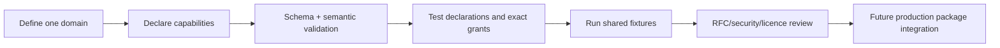

<!-- doc-key: developer-kit -->
<!-- parity-version: 2 -->
<!-- sections: contents,workflow,simulator,signing,conformance,production -->

# Ivy Developer Kit: start building your own module

[Nederlands](../../nl/development/developer-kit.md) | **English**

## What is the Developer Kit?

Want to build your own module for Ivy? The **Developer Kit** is a public toolbox for learning how a module describes itself, what functions it provides, and what permissions it needs.

It lets you **create examples, validate manifests and test selected Ivy rules** without installing the private Ivy Core. Think of a practice workshop: you can test tools and interfaces without having a full production installation.

**Important:** this kit is experimental. Passing its tests does not mean your module can already run in a real Ivy installation or has been approved for the Marketplace.

<!-- section: contents -->
## What's included?

| Component | What is it for? |
|---|---|
| Rust `ivy-devkit` | Library for public module contracts, validation and development tests |
| Dependency-free Dart development types | Types for working with public contract data |
| Developer Protocol Buffer declarations | Agreements defining the shape of public developer messages |
| Manifest JSON Schema | Rules for structuring a module description |
| CLI (`ivy-cli`) | Commands to generate an example module and validate a manifest |
| Offline widget preview | View an example widget as local HTML |
| `hello-clock` | Small example module to learn from |
| Conformance fixtures | Valid and invalid examples used to test validators |

The kit builds independently. It imports **no proprietary Core crate or data from the private Ivy repository**.

<!-- section: workflow -->
## Your first module, step by step

Imagine building a module that provides status information. Start with a name and domain, describe its capabilities (functions), validate the manifest and test the public contracts.

1. **Choose one clear domain.** What will your module own?
2. **Declare capabilities.** What functions does it offer and which functions does it need from others?
3. **Validate the manifest.** Are the fields correctly structured and the semantic rules respected?
4. **Use the simulator.** Check declarations, domain boundaries and separate permissions.
5. **Run conformance tests.** Verify expected valid and invalid behavior.
6. **Request review when needed.** Larger contract or security changes require an RFC (design proposal) first. A real production package is a later integration step.



**Try it:** run these commands from the repository root with Rust and Cargo installed.

```bash
cargo run -p ivy-cli -- new /tmp/status-module --id status-module --namespace community.example.status_module
cargo run -p ivy-cli -- validate /tmp/status-module/module.yaml
cargo test --workspace --locked
```

The first command creates an example module in `/tmp/status-module`, the second validates its manifest, and the third runs the workspace Rust tests. The `/tmp` path is an example for systems supporting that directory.

<!-- section: simulator -->
## What does the development simulator do?

The **simulator** lets you test the outcome of selected rules without running the full production Core.

It can check whether:
- a manifest is valid;
- failed module registration leaves no partial registration (**atomicity**);
- two modules claim overlapping capability domains;
- the correct handler receives the function call;
- a consumer has declared the function it needs beforehand;
- the provider is permitted to offer a function (**offer grant**) and the consumer is permitted to call it (**invocation grant**);
- the provider is available and a revoked permission is respected immediately (**revocation**).

The simulator runs **inside the development process** (*in-process*). It is not a runtime with real authenticated identities, durable storage or process isolation.

**Dynamic requirements** are not executed here: the `dynamic_requires` field exists in the manifest contract, but this preview does not expose a runtime API for approving such new requests.

<!-- section: signing -->
## What is development signing?

Signing helps check whether data has been modified after it was signed. The `ivy dev-keygen` and `ivy dev-sign` tools produce **Ed25519 signatures** with the explicit purpose `ivy-development-only`.

You can use these to practice integrity checks. **This is not official ANWOR signing.** It does not produce a production package, verified ANWOR provenance or Marketplace approval. Production key protection and recovery are not implemented in these development tools.

<!-- section: conformance -->
## How can I check whether my manifest follows the rules?

**Conformance** means checking whether something follows the agreed technical rules. Three kinds of test examples live under `conformance/manifests`:

| Type | Expected result |
|---|---|
| `valid` | Both validators accept the manifest |
| `schema-invalid` | The JSON structure is invalid and rejected |
| `semantic-invalid` | The structure is valid but violates an additional Rust rule |

Rust tests run the same examples through JSON Schema validation and semantic validation. Semantic failures include overlapping domains, contradictory declarations sharing an ID, and capabilities outside owned domains.

Read more in the [Conformance documentation](../../../conformance/README.md).

<!-- section: production -->
## When can my module run in real Ivy?

**A valid manifest and passing tests are a starting point, not complete production integration.**

A real external production module still needs public integration pieces such as:
- runtime bindings and communication contracts (**IPC/framing**);
- authenticated identity and trusted invocation context;
- lifecycle, health, sandbox and resource policies;
- an official package format and provenance signing;
- installation integration and Marketplace review tied to the exact module version.

These are **outstanding public integration steps**, not features quietly simulated by the kit.

**Where next?** Start with [Capabilities](../concepts/capabilities.md), explore the [manifest reference](manifest-reference.md), and learn about [Events and widgets](../concepts/events-widgets.md).
