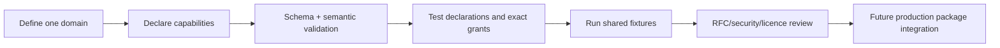

<!-- doc-key: developer-kit -->
<!-- parity-version: 2 -->
<!-- sections: contents,workflow,simulator,signing,conformance,production -->

# Developer Kit

[Nederlands](../../nl/development/developer-kit.md) | **English**

<!-- section: contents -->
## Included components

The independently buildable kit contains the Rust `ivy-devkit`, dependency-free
Dart development types, public developer protobuf, manifest JSON Schema, CLI,
offline widget preview, `hello-clock` and shared conformance fixtures. It imports
no proprietary Core crate or private repository data.

<!-- section: workflow -->
## Module development flow



```bash
cargo run -p ivy-cli -- new /tmp/status-module --id status-module --namespace community.example.status_module
cargo run -p ivy-cli -- validate /tmp/status-module/module.yaml
cargo test --workspace --locked
```

<!-- section: simulator -->
## Development simulator

The simulator enforces valid manifests, atomic registration, segment-based
exclusive domain ownership, exact handlers, static consumer declarations,
separate provider offer and consumer invocation grants, availability and
immediate revocation. It is in-process development infrastructure—not an
authenticated, persistent or isolated runtime.

Dynamic requirements are not supported. `dynamic_requires` remains in the
contract subset so manifests do not hide the architectural concept, but no
runtime approval API is exposed.

<!-- section: signing -->
## Development signing

`ivy dev-keygen` and `ivy dev-sign` create Ed25519 signatures with purpose
`ivy-development-only`. They test integrity tooling only. They cannot produce an
official package, ANWOR provenance or Marketplace approval, and they do not
implement production recovery or key protection.

<!-- section: conformance -->
## Conformance

Fixtures under `conformance/manifests` are divided into `valid`,
`schema-invalid` and `semantic-invalid`. Rust tests run the same fixtures through
JSON Schema and Rust semantic validation. Semantic-only checks include
overlapping domains, same-ID duplicates with different declarations and
capabilities outside owned domains.

<!-- section: production -->
## Path to production integration

A real external module still needs public runtime bindings, authenticated
identity, trusted invocation context, IPC/framing, lifecycle/health, sandbox and
resource policy, official package format, provenance signing, installation and a
version-specific Marketplace review. Those are documented gaps, not simulated
claims.
