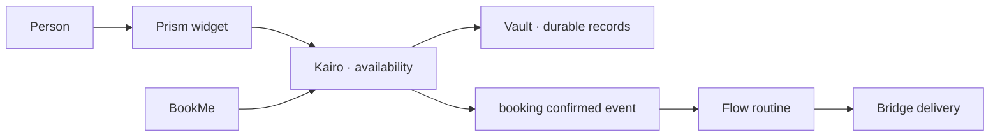

<!-- doc-key: usecases -->
<!-- parity-version: 2 -->
<!-- sections: collaboration,time,booking,electronics,automation,external -->

# Ivy use cases

[Nederlands](../../nl/usecases/README.md) | **English**

## What could someone use Ivy for?

These examples show how specialized modules cooperate on appointments, time tracking, electronics and automation. A *capability* is a named function, an *event* reports something that happened, and a *widget* displays information. **Check each example's status:** a scenario is not necessarily an installable public product.

Status labels mean **Implemented privately**, **Experimental publicly** or
**Planned**. They never imply a supported public production release.

<!-- section: collaboration -->
## Example of module collaboration

Each arrow represents a declared capability or event boundary; no module gains
general authority over another domain.

<!-- section: time -->
## Time registration and automation

**Modules:** Pulse, Flow, Vault and Prism.
**Capabilities:** clock/session operations, routine execution, storage and
widgets.
**Outcome:** a user records work locally and can trigger a reviewed routine after
a time event.
**Status:** Pulse and Flow foundations exist privately; the public module package
and end-user workflow are planned.

<!-- section: booking -->
## Kairo and bookings

**Modules:** Kairo, BookMe, Hooman, Bridge and Vault.
**Capabilities:** availability, free/busy, booking, identity attestation,
delivery and storage.
**Outcome:** a booking surface can request allowed availability without owning
the user's complete calendar.
**Status:** private implementations exist; no public reference source or
supported deployment is available.

<!-- section: electronics -->
## Local electronics and ESP32

**Modules:** a future third-party device provider, Bridge where external
transport is required, and Prism.
**Capabilities:** device readings and bounded commands under a dedicated domain.
**Outcome:** a maker can replace a hardware adapter without changing consumers.
**Status:** planned; no official ESP32 adapter is claimed.

<!-- section: automation -->
## Automation across independent modules

**Modules:** Flow plus any providers selected by the user.
**Capabilities:** declared triggers/actions, approvals and compensations.
**Outcome:** durable routines coordinate modules without making Flow the owner of
their domain data.
**Status:** private Flow foundations exist; public runtime integration is
missing.

<!-- section: external -->
## Independent external modules

**Modules:** any independently authored provider that follows public contracts.
**Capabilities:** the author's explicit domain and versioned operations.
**Outcome:** authors can distribute original modules for free or payment, open or
closed source, when they hold the necessary rights.
**Status:** policy is documented; official Marketplace admission and
`ANWOR Verified` require a separate review of the exact package version.
