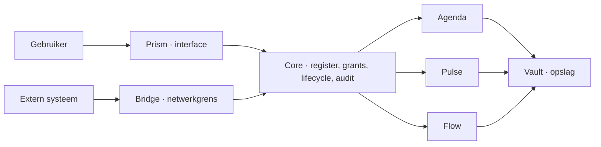

<!-- doc-key: home -->
<!-- parity-version: 2 -->
<!-- sections: overview,why,audience,architecture,control,status,examples,participate,documentation -->

# Ivy Developer Kit

**Nederlands** | [English](../en/README.md)

> **Developerpreview.** Ivy is niet productierijp, de publieke API is niet
> stabiel en deze repository bevat niet de volledige proprietary runtime.

<!-- section: overview -->
## Wat is Ivy?

Ivy is een local-first capabilityplatform voor modulaire softwaresystemen die
onder controle van de gebruiker blijven. In plaats van één toepassing die elk
domein bezit, leveren onafhankelijke modules kleine, expliciete en
geversioneerde capabilities. Ivy Core selecteert de geïnstalleerde provider,
beoordeelt declaraties en exacte grants, routeert de aanvraag en registreert de
uitkomst.

Local-first betekent dat lokale werking en lokale gegevens de normale route
zijn—niet slechts een tijdelijke offline cache rond een verplichte clouddienst.
Externe diensten kunnen nog steeds deelnemen via gecontroleerde modules en
Bridge.

<!-- section: why -->
## Waarom bestaat Ivy?

Digitale hulpmiddelen koppelen identiteit, opslag, interface, automatisering en
bedrijfslogica vaak zo sterk dat gebruikers niet één onderdeel kunnen vervangen
zonder alles te vervangen. Ivy scheidt die verantwoordelijkheden. Het doel is
niet nog een grote automatiseringsapp of een winkel met plugins; het doel is een
platform met begrensde bevoegdheid, vervangbare providers en installaties die
nooit stilzwijgend toestemming geven.

<!-- section: audience -->
## Voor wie is Ivy bedoeld?

- makers die lokale hardware of diensten verbinden;
- Rust-, Dart- en systeemontwikkelaars die modules en tools bouwen;
- privacygerichte self-hosters die de weg naar installeerbare releases volgen;
- organisaties die lokale, controleerbare samenwerking tussen domeinen nodig hebben;
- onderzoekers van duurzame, offline of capabilitygebaseerde systemen.

Vandaag is de publieke repository vooral bedoeld voor ontwikkelaars en technische
evaluatoren. Eenvoudige installatie voor eindgebruikers is gepland, niet
geïmplementeerd.

<!-- section: architecture -->
## Hoe werken modules samen?



- **Core** is de proprietary platformautoriteit voor registratie, grants,
  routing, lifecycle, health, audit en package trust.
- **Core UI** is de proprietary lokale beheerinterface.
- **Prism** stelt generieke gebruikerservaringen en declaratieve widgets samen.
- **Bridge** is de gecontroleerde externe netwerk- en kanaalgrens.
- **Vault** levert duurzame lokale opslagcapabilities.
- Domeinmodules zoals Agenda en Pulse bezitten hun domeinsemantiek.

Consumers roepen capability-ID's aan, geen hardgecodeerde module-ID's. Eén
geïnstalleerde eigenaar mag een capabilitydomein beheren. De development
simulator toont dit model, maar is geen Core en vormt geen productiebeveiliging.

<!-- section: control -->
## Wat betekent gebruikerscontrole?

Een provider heeft een exacte offer grant nodig. Een consumer heeft een exacte
invocation grant nodig en moet de capability als requirement hebben
gedeclareerd. Het intrekken van één van beide grants stopt volgende aanroepen in
de development simulator onmiddellijk. Production Ivy voegt geauthenticeerde
calleridentiteit, trusted context, procesisolatie, persistentie, lifecycle en
auditgaranties toe die hier niet worden nagebootst.

<!-- section: status -->
## Wat werkt momenteel?

**Geïmplementeerd in private Ivy-development:** capability-domainownership,
default-deny grants, capabilityrouting, Linux-hostfundamenten, native
Prism-flows, ondertekende lokale packages en werkende systeem- en domeinmodules.

**Experimenteel in deze repository:** publieke manifestsubset, Rust-SDK,
development simulator, Dart-types, manifestvalidator, modulegenerator,
development signing, widgetfixturepreview, gedeelde conformancefixtures en het
`hello-clock`-voorbeeld.

**Gepland:** stabiele publieke runtime-integratie, officiële packagevalidatie,
referentiemodules, eenvoudige installatie, upgrades, backup en Marketplace.

**Onderzocht:** federatie, offline transport, mobiliteit, optimalisatie, AI en
aanvullende domeinmodules.

<!-- section: examples -->
## Praktijkvoorbeelden

- Pulse-tijdgebeurtenissen kunnen een Flow-routine starten; productie-integratie
  bestaat privé, terwijl publieke packaging nog gepland is.
- Agenda-beschikbaarheid kan BookMe-boekingsbeslissingen ondersteunen; publieke
  referentiebroncode is nog niet vrijgegeven.
- Een externe maker kan een ESP32-capability aanbieden via een gereviewde module;
  de hardwareadapter en publieke runtimebridge zijn gepland.
- Onafhankelijke modules mogen gratis, betalend, proprietary of open source zijn
  wanneer de auteur de nodige rechten bezit.

Zie [toepassingen](usecases/README.md) voor precieze status en capabilityflows.

<!-- section: participate -->
## Bouwen en deelnemen

```bash
cargo test --workspace --locked
cargo run -p ivy-cli -- validate examples/hello-clock/module.yaml
cargo run -p ivy-hello-clock
```

Begin met de [eerste-modulehandleiding](tutorials/first-module.md) en lees daarna
de [bijdragerichtlijnen](community/contributing.md). Toelating tot de Marketplace
is een afzonderlijke, versiegebonden ANWOR-review. `ANWOR Official` en
`ANWOR Verified` mogen nooit zonder die goedkeuring worden geclaimd.

<!-- section: documentation -->
## Documentatie

- [Architectuur en compatibiliteit](architecture/overview.md)
- [Capabilities en grants](concepts/capabilities.md)
- [Events en widgets](concepts/events-widgets.md)
- [Developer Kit en manifestregels](development/developer-kit.md)
- [Toepassingen](usecases/README.md)
- [Module- en Marketplacebeleid](modules/module-categories.md)
- [Bijdragen en eerste taken](community/contributing.md)
- [Status en roadmap](project/status-roadmap.md)
- [Licenties en publicatiebeslissingen](project/licenses-trademarks.md)
- [FAQ](faq/README.md)
