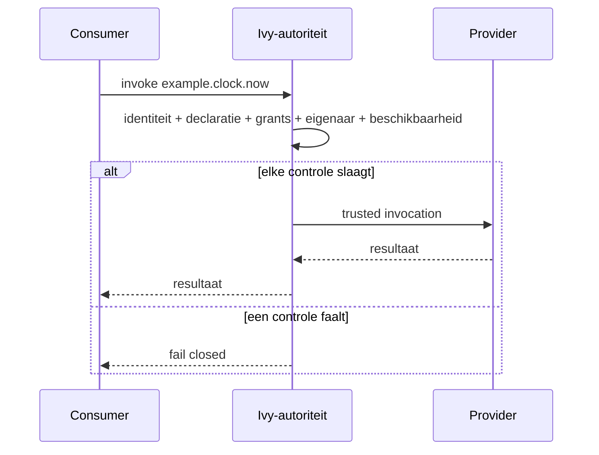
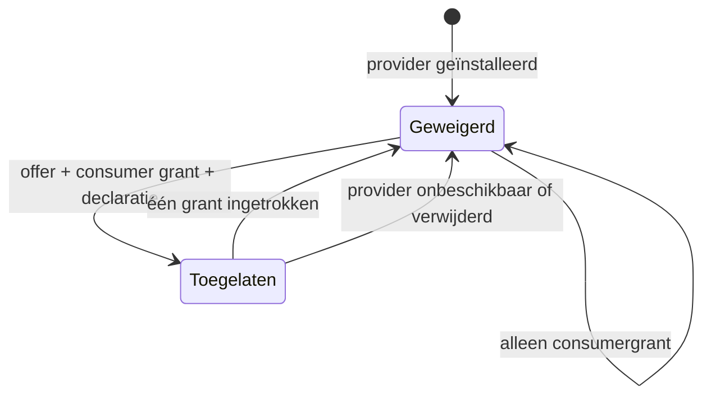

<!-- doc-key: capabilities -->
<!-- parity-version: 2 -->
<!-- sections: identifiers,ownership,invocation,grants,revocation,limits -->

# Capabilities, ownership en grants

**Nederlands** | [English](../../en/concepts/capabilities.md)

<!-- section: identifiers -->
## Identifiers

Een module-ID identificeert een implementatie. Een capability-ID identificeert
een geversioneerde operatie zoals `example.clock.now`. Een capabilitydomein
zoals `example.clock` bepaalt bevoegdheid. Consumers hangen af van
capability-ID's, niet van een specifieke providermodule.

<!-- section: ownership -->
## Exclusief ownership

Eén geïnstalleerde module mag een domein bezitten. `example.clock` conflicteert
met zowel `example.clock` als `example.clock.backup`; `example.clockwork`
conflicteert niet omdat overlap per puntgescheiden segment wordt beoordeeld. Eén
manifest mag evenmin overlappende domeinen claimen. Mislukte
simulatorregistratie is atomisch.

<!-- section: invocation -->
## Capabilityflow

<!-- section: grants -->
## Twee onafhankelijke grants

Een provider offer grant machtigt één geïnstalleerde provider om één
gedeclareerde capability aan te bieden. Een consumer invocation grant machtigt
één gedeclareerde consumer om die capability aan te roepen. Beide moeten bestaan;
er zijn geen wildcardrechten. De simulator ondersteunt alleen statische
consumerrequirements.

<!-- section: revocation -->
## Grant- en revocationflow

<!-- section: limits -->
## Grenzen van de simulator

De simulator gebruikt geregistreerde module-ID's als expliciete
testidentiteiten. Production Core authenticeert echte callers en levert trusted
context afzonderlijk. De simulator implementeert geen dynamic-requestapproval,
procesisolatie, persistente grants, lifecyclefencing of audit.
