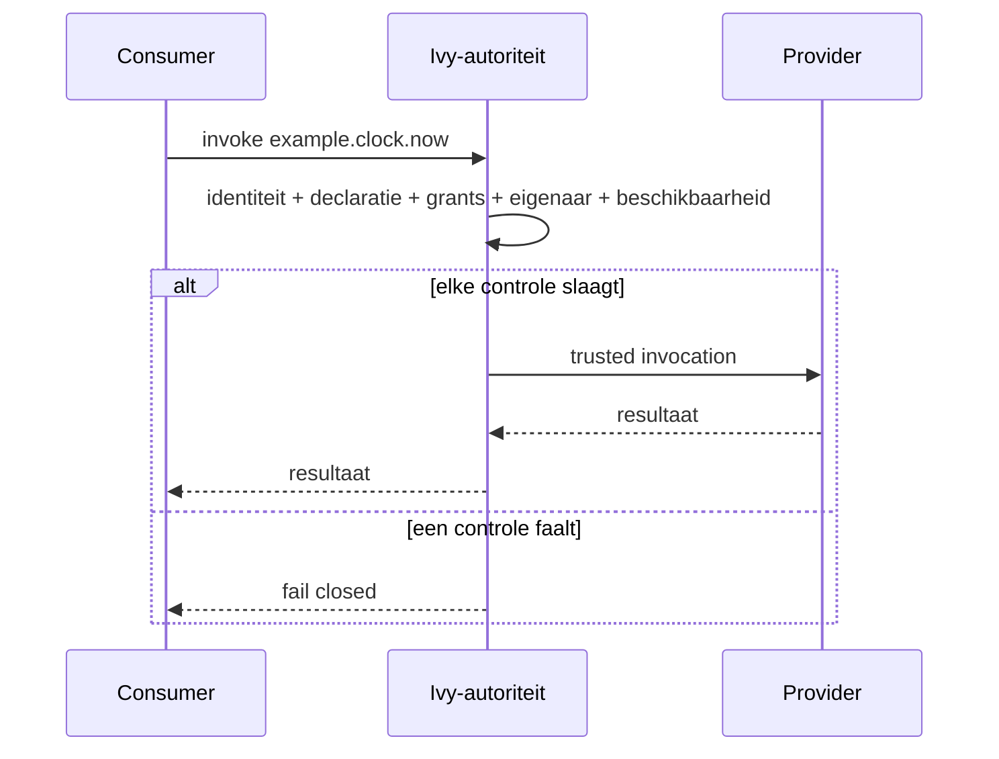
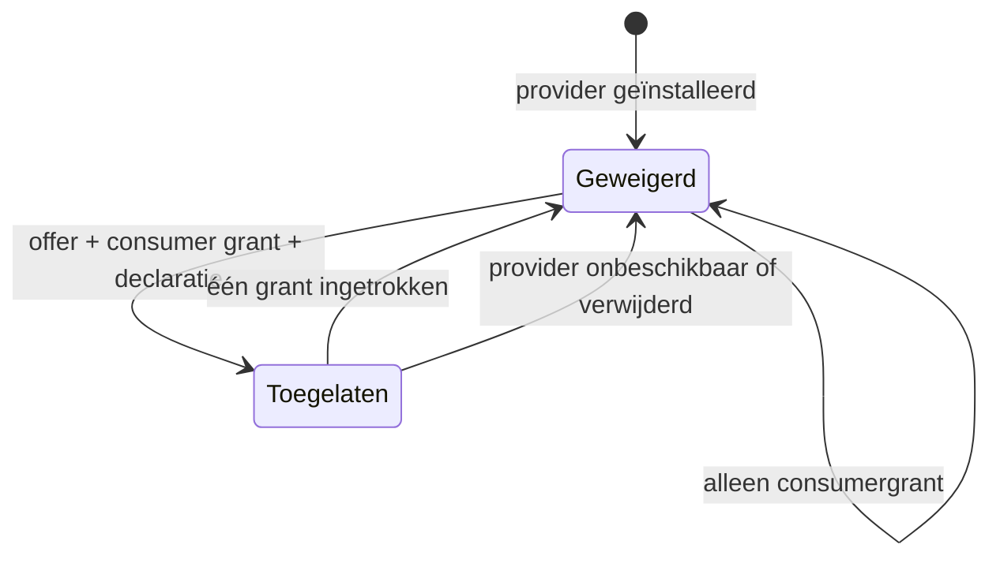

<!-- doc-key: capabilities -->
<!-- parity-version: 2 -->
<!-- sections: identifiers,ownership,invocation,grants,revocation,limits -->

# Capabilities: hoe Ivy-modules veilig samenwerken

**Nederlands** | [English](../../en/concepts/capabilities.md)

## Begin hier: wat is een capability?

Ivy bestaat uit modules die elk een eigen taak uitvoeren. Een **capability** is een duidelijk benoemde functie die zo'n module aanbiedt en die een andere module kan gebruiken.

Denk aan een module voor slimme verlichting. Die kan bijvoorbeeld deze functies aanbieden:

- `home.lighting.turn_on` — een lamp inschakelen.
- `home.lighting.turn_off` — een lamp uitschakelen.
- `home.lighting.get_state` — de toestand van een lamp opvragen.

Een automatiseringsmodule hoeft dan niet te weten hoe de lamp technisch werkt. Ze vraagt een benoemde functie aan. **Ivy controleert wie de functie aanbiedt en of de aanroep is toegestaan.** Een andere implementatie kan dezelfde geschikte capability overnemen, mits de ownership-, contract- en toegangsregels worden gerespecteerd.

**Drie begrippen:**
- **Provider:** de module die een capability aanbiedt, bijvoorbeeld de verlichtingsmodule.
- **Consumer:** de module die de capability wil gebruiken, bijvoorbeeld de automatiseringsmodule.
- **Grant:** een expliciete toestemming. Alleen een functie declareren is niet voldoende om ze te mogen aanbieden of gebruiken.

Dit document beschrijft de architectuurregels en wat de **publieke simulator** daarvan kan testen. Het is geen garantie dat een externe module vandaag al via een publieke productie-API kan worden aangesloten.

<!-- section: identifiers -->
## Hoe herken je een module en haar functies?

Een **module-ID** identificeert een concrete implementatie. Een **capability-ID** identificeert een geversioneerde operatie, zoals `example.clock.now`. Een **capabilitydomein** groepeert functies en bepaalt het gebied waarvoor een module eigenaar mag zijn, bijvoorbeeld `example.clock`.

Dit onderscheid zorgt ervoor dat een consumer zich op de benodigde *functie* richt en niet hard hoeft te verwijzen naar één specifieke providermodule. Bij vervanging moeten natuurlijk wel de benodigde versie en het contract compatibel blijven.

<!-- section: ownership -->
## Waarom mag maar één module eigenaar zijn van een domein?

Stel dat twee modules tegelijk beweren verantwoordelijk te zijn voor dezelfde verlichting. Dan wordt onduidelijk wie verzoeken moet ontvangen. Daarom heeft elk capabilitydomein **één exclusieve geïnstalleerde eigenaar**.

De controle kijkt naar segmenten die door punten gescheiden zijn:

- `example.clock` en `example.clock` **conflicteren**: exact hetzelfde domein.
- `example.clock` en `example.clock.backup` **conflicteren**: het tweede valt onder het eerste.
- `example.clock` en `example.clockwork` **conflicteren niet**: het zijn verschillende segmentnamen.

Eén manifest mag ook niet zelf overlappende domeinen claimen. In de simulator is een mislukte registratie **atomisch**: een fout laat geen gedeeltelijk geslaagde registratie achter.

Eigendom betekent overigens **niet** dat andere modules de functies nooit mogen gebruiken. Dat kan met afzonderlijke toestemmingen.

<!-- section: invocation -->
## Wat gebeurt er als een module een functie aanroept?

Stel: de automatiseringsmodule wil weten hoe laat het is. Ze vraagt `example.clock.now` aan. De provider voert de functie pas uit als Ivy de toepasselijke controles heeft doorlopen.

1. De **consumer** vraagt de capability aan.
2. **Ivy** controleert onder andere identiteit, declaratie, toestemmingen, eigenaar en beschikbaarheid.
3. Als alles klopt, wordt de aanroep naar de **provider** gerouteerd en komt het resultaat terug.
4. Als een vereiste controle faalt, wordt de aanroep **geweigerd** (*fail closed*). Ivy geeft dan niet stilzwijgend extra rechten.

Het onderstaande diagram toont deze stroom:

<!-- section: grants -->
## Waarom zijn er twee aparte toestemmingen?

Het lijkt logisch dat een geïnstalleerde module haar functies meteen mag aanbieden en dat andere modules die kunnen gebruiken. Ivy doet dat **bewust niet automatisch**.

- Een **provider offer grant** geeft één geïnstalleerde provider toestemming om **één gedeclareerde capability aan te bieden**.
- Een **consumer invocation grant** geeft één consumer toestemming om **die gedeclareerde capability aan te roepen**.

**Beide grants moeten bestaan.** Alleen de aanbiedkant toestaan is onvoldoende; alleen de gebruikskant toestaan ook. Er zijn geen wildcardrechten die in één keer alle capabilities toestaan.

De publieke simulator ondersteunt hier alleen **statisch vooraf gedeclareerde behoeften** (*static consumer requirements*), geen dynamische aanvragen tijdens uitvoering.

<!-- section: revocation -->
## Wat als toestemming wordt ingetrokken?

Toestemming is niet permanent. **Revocation** betekent dat een eerder gegeven grant wordt ingetrokken.

Ook als alles eerst werkte, moet een volgende aanroep weer worden geweigerd als de provider- of consumergrant is ingetrokken, of als de provider niet meer beschikbaar of verwijderd is.

Het diagram toont wanneer de toestand wisselt tussen geweigerd en toegelaten:

<!-- section: limits -->
## Wat bewijst de publieke simulator wel en niet?

De publieke simulator laat ontwikkelaars bepaalde regels rond manifesten, domeineigendom, declaraties, beschikbaarheid, grants, routering en intrekking testen.

**Maar de simulator is niet de volledige beveiligde Ivy Core.** Hij gebruikt geregistreerde module-ID's als testidentiteiten. De productie-Core authenticeert echte aanroepers en levert een afzonderlijke vertrouwde context.

De simulator implementeert **geen**:
- goedkeuring van dynamische capabilityverzoeken;
- procesisolatie;
- persistent opgeslagen grants;
- lifecyclefencing;
- audit.

Een geslaagde simulatortest is dus **geen productietoelating of Marketplace-certificering**.

Meer weten? Bekijk de [architectuuruitleg](../architecture/overview.md), de [manifestreferentie](../development/manifest-reference.md) en de [conformancetests](../../../conformance/README.md).
