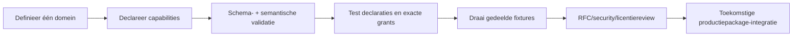

<!-- doc-key: developer-kit -->
<!-- parity-version: 2 -->
<!-- sections: contents,workflow,simulator,signing,conformance,production -->

# Developer Kit

**Nederlands** | [English](../../en/development/developer-kit.md)

<!-- section: contents -->
## Meegeleverde onderdelen

De onafhankelijk bouwbare kit bevat de Rust `ivy-devkit`, dependencyvrije
Dart-developmenttypes, publieke developerproto, manifest-JSON Schema, CLI,
offline widgetpreview, `hello-clock` en gedeelde conformancefixtures. De kit
importeert geen proprietary Core-crate of gegevens uit de private repository.

<!-- section: workflow -->
## Moduleontwikkelingsflow



```bash
cargo run -p ivy-cli -- new /tmp/status-module --id status-module --namespace community.example.status_module
cargo run -p ivy-cli -- validate /tmp/status-module/module.yaml
cargo test --workspace --locked
```

<!-- section: simulator -->
## Development simulator

De simulator dwingt geldige manifests, atomische registratie,
segmentgebaseerd exclusief domeinownership, exacte handlers, statische
consumerdeclaraties, afzonderlijke provider offer- en consumer invocation
grants, beschikbaarheid en onmiddellijke revocation af. Het is in-process
developmentinfrastructuur—geen geauthenticeerde, persistente of geïsoleerde
runtime.

Dynamic requirements worden niet ondersteund. `dynamic_requires` blijft in de
contractsubset zodat manifests het architectuurconcept niet verbergen, maar er
is geen runtimegoedkeurings-API.

<!-- section: signing -->
## Development signing

`ivy dev-keygen` en `ivy dev-sign` maken Ed25519-signatures met purpose
`ivy-development-only`. Ze testen alleen integritytools. Ze kunnen geen officiële
package, ANWOR-provenance of Marketplacegoedkeuring maken en implementeren geen
productierecovery of key protection.

<!-- section: conformance -->
## Conformance

Fixtures onder `conformance/manifests` zijn verdeeld in `valid`,
`schema-invalid` en `semantic-invalid`. Rust-tests voeren dezelfde fixtures door
JSON Schema en semantische Rust-validatie. Semantische controles omvatten
overlappende domeinen, duplicaten met hetzelfde ID maar andere declaraties en
capabilities buiten owned domains.

<!-- section: production -->
## Weg naar productie-integratie

Een echte externe module heeft nog publieke runtimebindings, geauthenticeerde
identiteit, trusted invocation context, IPC/framing, lifecycle/health,
sandbox- en resourcebeleid, officieel packageformat, provenance signing,
installatie en een versiegebonden Marketplace-review nodig. Dat zijn
gedocumenteerde hiaten, geen gesimuleerde claims.
