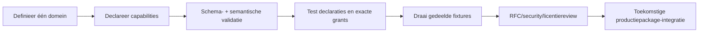

<!-- doc-key: developer-kit -->
<!-- parity-version: 2 -->
<!-- sections: contents,workflow,simulator,signing,conformance,production -->

# Ivy Developer Kit: begin met je eigen module

**Nederlands** | [English](../../en/development/developer-kit.md)

## Wat is de Developer Kit?

Wil je zelf een module voor Ivy bouwen? De **Developer Kit** is je publieke gereedschapskist om te leren hoe een module zichzelf beschrijft, welke functies ze aanbiedt en welke rechten ze nodig heeft.

Je kunt er **voorbeelden mee maken, manifests controleren en bepaalde Ivy-regels testen**, zonder de private Ivy Core te installeren. Denk aan een oefenwerkplaats: je kunt gereedschap en aansluitingen testen, maar je hebt daarmee nog geen volledige productie-installatie.

**Belangrijk:** deze kit is experimenteel. Een geslaagde test betekent niet dat je module vandaag al in een echte Ivy-installatie kan draaien of in de Marketplace is goedgekeurd.

<!-- section: contents -->
## Wat zit er in de kit?

| Onderdeel | Wat heb je eraan? |
|---|---|
| Rust `ivy-devkit` | Bibliotheek voor publieke modulecontracten, validatie en ontwikkeltests |
| Dart-developmenttypes zonder externe dependencies | Types om met publieke contractgegevens te werken |
| Developer-protobufdeclaraties | Afspraken over de structuur van publieke ontwikkelaarsberichten |
| Manifest JSON Schema | Regels voor de opbouw van de modulebeschrijving |
| CLI (`ivy-cli`) | Commando's om een voorbeeldmodule te maken en een manifest te controleren |
| Offline widgetpreview | Een voorbeeldwidget als lokale HTML bekijken |
| `hello-clock` | Kleine voorbeeldmodule om van te leren |
| Conformancefixtures | Geldige en ongeldige voorbeelden waarmee de validators worden getest |

De kit kan zelfstandig gebouwd worden. Ze importeert **geen proprietaire Core-crate of gegevens uit de private Ivy-repository**.

<!-- section: workflow -->
## Je eerste module stap voor stap

Stel dat je een module wilt maken die statusinformatie aanbiedt. Je begint met een naam en domein, beschrijft haar capabilities (functies), controleert het manifest en test de publieke afspraken.

1. **Kies één duidelijk domein.** Wat moet jouw module beheren?
2. **Declareer de capabilities.** Wat biedt ze aan, en wat heeft ze nodig van andere modules?
3. **Controleer het manifest.** Zijn de velden geldig en worden de inhoudelijke regels gerespecteerd?
4. **Test met de simulator.** Kloppen de declaraties, domeingrenzen en afzonderlijke toestemmingen?
5. **Draai de conformance-tests.** Controleren de voorbeelden het verwachte geldige én ongeldige gedrag?
6. **Vraag waar nodig een review aan.** Grotere contract- of beveiligingswijzigingen vragen vooraf een RFC (ontwerpvoorstel). Een echt productiepackage is een latere integratiestap.



**Probeer het uit:** voer deze commando's uit vanuit de hoofdmap van de repository, met Rust en Cargo geïnstalleerd.

```bash
cargo run -p ivy-cli -- new /tmp/status-module --id status-module --namespace community.example.status_module
cargo run -p ivy-cli -- validate /tmp/status-module/module.yaml
cargo test --workspace --locked
```

Het eerste commando maakt een voorbeeldmodule in `/tmp/status-module`, het tweede controleert haar manifest en het derde voert de Rust-tests van de workspace uit. Het pad `/tmp` is een voorbeeld voor systemen die die map ondersteunen.

<!-- section: simulator -->
## Waarvoor dient de ontwikkelsimulator?

De **simulator** laat je testen hoe bepaalde regels zouden uitpakken zonder de volledige productie-Core te gebruiken.

Zo kan hij controleren of:
- een manifest geldig is;
- een module zich niet gedeeltelijk registreert wanneer registratie faalt (**atomisch**);
- twee modules geen overlappende capabilitydomeinen bezitten;
- de juiste handler (functieafhandeling) wordt aangesproken;
- een consumer vooraf verklaard heeft welke functie ze nodig heeft;
- de provider toestemming heeft om een functie aan te bieden (**offer grant**) én de consumer toestemming heeft om ze aan te roepen (**invocation grant**);
- de provider beschikbaar is en een ingetrokken toestemming onmiddellijk wordt gerespecteerd (**revocation**).

De simulator werkt **binnen het ontwikkelproces** (*in-process*). Hij is geen runtime met echte aanmeldeidentiteiten, permanente opslag of procesisolatie.

**Dynamische behoeften** worden hier nog niet uitgevoerd: het veld `dynamic_requires` bestaat wel in het manifestcontract, maar deze preview heeft geen runtime-API om zulke nieuwe verzoeken goed te keuren.

<!-- section: signing -->
## Wat is development signing?

Ondertekenen helpt controleren of gegevens na het ondertekenen veranderd zijn. De tools `ivy dev-keygen` en `ivy dev-sign` maken hiervoor **Ed25519-handtekeningen** met het expliciete doel `ivy-development-only`.

Je kunt hiermee de integriteitscontrole oefenen. **Dit is geen officiële ANWOR-ondertekening.** Het levert geen productiepackage, bewezen ANWOR-herkomst (*provenance*) of Marketplacegoedkeuring op. Bescherming en herstel van productiesleutels zijn niet geïmplementeerd in deze ontwikkeltools.

<!-- section: conformance -->
## Hoe weet je of je manifest aan de regels voldoet?

**Conformance** betekent: nagaan of iets aan de afgesproken technische regels voldoet. Onder `conformance/manifests` staan drie soorten testvoorbeelden:

| Soort | Wat verwachten we? |
|---|---|
| `valid` | Het manifest wordt door beide validators geaccepteerd |
| `schema-invalid` | De JSON-structuur is ongeldig en wordt geweigerd |
| `semantic-invalid` | De structuur klopt, maar de inhoud overtreedt een extra Rust-regel |

De Rust-tests controleren dezelfde voorbeelden met het JSON Schema en de semantische validator. Voorbeelden van semantische fouten zijn overlappende domeinen, tegenstrijdige declaraties met hetzelfde ID en capabilities buiten een eigen domein.

Lees meer in de [Conformance-documentatie](../../../conformance/README.md).

<!-- section: production -->
## Wanneer kan mijn module echt in Ivy draaien?

Een **geldig manifest en geslaagde tests zijn een begin, geen volledige productie-integratie**.

Voor een echte externe productiemodule ontbreken in de publieke kit nog onder andere:
- publiek beschikbare runtimebindings en communicatieafspraken (**IPC/framing**);
- geauthenticeerde identiteit en vertrouwde context bij aanroepen;
- lifecycle-, health-, sandbox- en resourcebeleid;
- een officieel packageformaat en ondertekening met aantoonbare herkomst;
- installatie-integratie en een Marketplace-review voor de specifieke moduleversie.

Dit zijn **openstaande publieke integratiestappen**, geen functies die de simulator stilzwijgend nabootst.

**Waar verder lezen?** Begin bij [Capabilities](../concepts/capabilities.md), bekijk de [manifestreferentie](manifest-reference.md) en leer hoe [Events en widgets](../concepts/events-widgets.md) werken.
