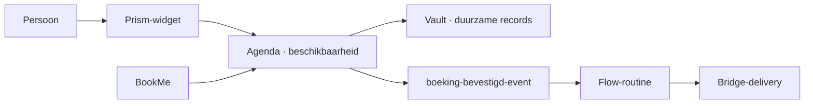

<!-- doc-key: usecases -->
<!-- parity-version: 2 -->
<!-- sections: collaboration,time,booking,electronics,automation,external -->

# Ivy-toepassingen

**Nederlands** | [English](../../en/usecases/README.md)

Statuslabels betekenen **Privé geïmplementeerd**, **Publiek experimenteel** of
**Gepland**. Ze impliceren nooit een ondersteunde publieke productierelease.

<!-- section: collaboration -->
## Voorbeeld van modulesamenwerking

Elke pijl vertegenwoordigt een gedeclareerde capability- of eventgrens; geen
module krijgt algemene bevoegdheid over een ander domein.

<!-- section: time -->
## Tijdregistratie en automatisering

**Modules:** Pulse, Flow, Vault en Prism.
**Capabilities:** klok-/sessieoperaties, routine-execution, storage en widgets.
**Resultaat:** een gebruiker registreert werk lokaal en kan na een tijd-event een
gereviewde routine starten.
**Status:** Pulse- en Flow-fundamenten bestaan privé; de publieke modulepackage en
eindgebruikersflow zijn gepland.

<!-- section: booking -->
## Agenda en boekingen

**Modules:** Agenda, BookMe, Hooman, Bridge en Vault.
**Capabilities:** availability, free/busy, booking, identity attestation,
delivery en storage.
**Resultaat:** een boekingsoppervlak kan toegelaten beschikbaarheid opvragen
zonder de volledige agenda van de gebruiker te bezitten.
**Status:** private implementaties bestaan; er is geen publieke referentiebron of
ondersteunde deployment.

<!-- section: electronics -->
## Lokale elektronica en ESP32

**Modules:** een toekomstige externe deviceprovider, Bridge wanneer extern
transport nodig is, en Prism.
**Capabilities:** devicemetingen en begrensde commands onder een eigen domein.
**Resultaat:** een maker kan een hardwareadapter vervangen zonder consumers aan
te passen.
**Status:** gepland; er wordt geen officiële ESP32-adapter geclaimd.

<!-- section: automation -->
## Automatisering tussen onafhankelijke modules

**Modules:** Flow plus providers die de gebruiker kiest.
**Capabilities:** gedeclareerde triggers/acties, approvals en compensaties.
**Resultaat:** duurzame routines coördineren modules zonder Flow eigenaar van hun
domeingegevens te maken.
**Status:** private Flow-fundamenten bestaan; publieke runtime-integratie ontbreekt.

<!-- section: external -->
## Onafhankelijke externe modules

**Modules:** elke onafhankelijk ontwikkelde provider die de publieke contracten
volgt.
**Capabilities:** het expliciete domein en geversioneerde operaties van de auteur.
**Resultaat:** auteurs kunnen originele modules gratis of betalend, open of closed
source verspreiden wanneer ze de nodige rechten bezitten.
**Status:** het beleid is gedocumenteerd; officiële Marketplaceopname en
`ANWOR Verified` vereisen een afzonderlijke review van de exacte packageversie.
